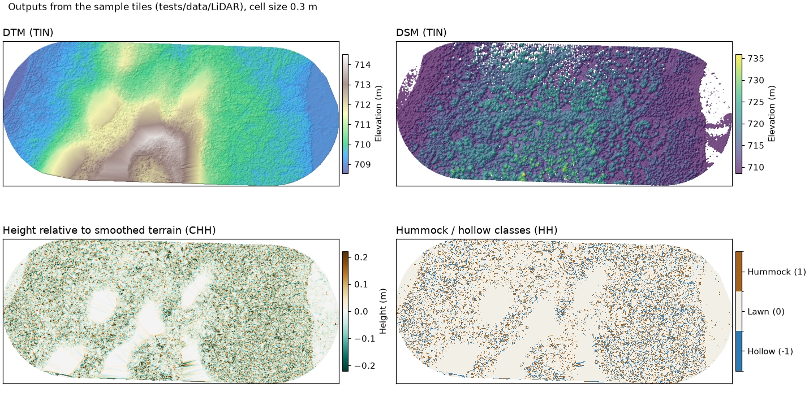

# About

BERA Tools is a series of script tools for facilitating the high-resolution mapping and studying of forest lines (petroleum exploration corridors in forested areas) via processing canopy height models (LiDAR or photogrammetry derived raster images where pixel-values represent the ground-height of vegetation).

## Motivation

Given that the process of manually digitizing detailed small-scale
(boreal) forest lines is slow and prone to human error, a semi-automated
solution is preferred for large-scale application areas. Additionally,
high-resolution CHMs allow for improved forest line spatial analysis.

## PC2Products (LiDAR) tools

The **PC2Products** (Point Cloud to Products) category turns LiDAR point clouds (`.las` / `.laz`)
into raster products such as a **DTM**, **DSM**, **CHM** and **hummock/hollow** maps. It also
includes tools for checking the input data, classifying ground points, mapping surface water and
depth to water, and comparing seismic lines with the surrounding peatland.

*Rasters produced from the sample tiles in `tests/data/LiDAR/` (ground-classified with CSF first, cell
size 0.3 m). Top: DTM and DSM, both built with TIN. Bottom: the hummock/hollow tool's two outputs,
using `Smooth_by = median`, `Min_ws = 3` and `lawn_range = 0.1`.*

These tools call R functions in `r_scripts_collection.r` through [rpy2](https://rpy2.github.io/),
using [lidR](https://r-lidar.github.io/lidRbook/) for the processing. The CHM they make can feed the
mapping tools directly, for example in a GUI pipeline.

## Credit

This tool is part of the [**Boreal Ecosystem Recovery and Assessment (BERA)**](http://www.beraproject.org/) Project, and is being actively developed by the [**Applied Geospatial Research Group**](https://www.appliedgrg.ca/).

## Code signing policy

BERA Tools Windows signing is currently off by default and can be enabled per run according to the project [Code signing policy](https://github.com/BERATool/beratools/blob/main/CODE_SIGNING_POLICY.md). Unsigned releases use the `-unsigned.exe` suffix and are identified as unsigned in the release notes.

### Cite Us

If you use BERA Tools for a publication, please cite it as:

    @misc{BERA Tools,
      author = "Applied Geospatial Research Group",
      title = "Forest Line Mapper",
      howpublished = "\url{https://github.com/BERATool/beratools}",
    }

## Credits

This tool is part of the Boreal Ecosystem Recovery and Assessment (BERA)
Project, and was developed by the Applied Geospatial Research Group.

## Reference

The Forest Line Mapper: A Semi-Automated Tool for Mapping Linear Disturbances in Forests,
Gustavo Lopes Queiroz, Gregory J. McDermid, Mir Mustafizur Rahman, and Julia Linke. _Remote Sens._ 2020, 12(24), 4176.  
[https://doi.org/10.3390/rs12244176](https://doi.org/10.3390/rs12244176)

Surface Water Mapping, Depth-to-Water from Surface Water and Seismic Line Disturbance Analysis follow
Chan, Dabros & McDermid (2026),
[*Microtopographic and Hydrological Response to Repeated Seismic Line Disturbance in a Boreal Fen of
Northern Alberta, Canada*](https://doi.org/10.3390/f17040489), *Forests* 17, 489.

## License

BERA Tools is release under the GPL 3.0 (GNU General Public License
v3.0). Please refer to the LICENSE file contained in the source for
complete license description.

*Copyright (C) 2026  Applied Geospatial Research Group*
