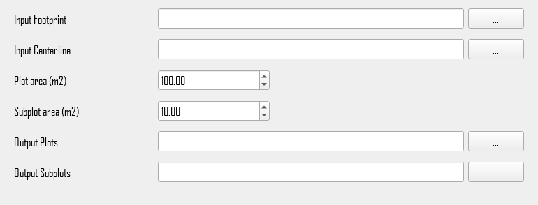

# Footprint Plots and Subplots

## What does this tool do?

**Footprint Plots and Subplots** splits line footprints into plots and subplots along their centerlines. This is useful for field sampling or for summarizing data along a line in equal-area units.

- A **plot** covers both sides of the line. Each side is a separate feature, labelled left (`L`) or right (`R`) relative to the line direction.
- A **subplot** is a smaller unit on one side of the line. Subplots nest inside plots.

The tool is ported from [SegLine](https://github.com/IrinaTerentieva/SegLine) by Irina Terentieva.

## How do I use it?

### Quick Start

1. **Prepare your input files**: footprint polygons, for example the output of [Canopy Footprint](canopy_footprint_abs.md) or [Ground Footprint](ground_footprint.md), and the centerlines of those footprints.
2. **Run the tool** from GUI. The area options are under **Show Advanced Options**:

   

3. **Open the two output files** in your GIS software. Symbolize by `plot_id` and `side` to see the plots.

## What options can I set?

- **Input Footprint**: Path to your input footprint polygon file
- **Input Centerline**: Path to the centerlines of the footprints. Each footprint uses the centerline that overlaps it the most, so the two files don't need a shared ID field.
- **Plot area (m2)**: Target plot area covering both sides of the line (default: `100`)
- **Subplot area (m2)**: Target subplot area on one side of the line (default: `10`)
- **Output Plots**: Path for the output plots, one feature per plot side
- **Output Subplots**: Path for the output subplots

## How are plots sized?

The tool estimates the average width of each footprint as its area divided by the length of the centerline inside it. It then spaces cuts along the centerline so that subplots get close to the target area:

- Subplot length along the line = 2 × subplot area ÷ width
- Subplots per side of a plot = plot area ÷ (2 × subplot area), rounded to a whole number

The plot area must be at least 2 × the subplot area. Where the footprint is wider or narrower than average, those subplots are larger or smaller. The mean subplot area still matches the target. At the end of a line, a piece shorter than half a subplot joins the last subplot.

## Output attributes

Both outputs keep the footprint attributes, plus any centerline attributes the footprint doesn't already have, and add:

| Field | Description |
|---|---|
| `FP_ID` | Index of the input footprint |
| `plot_id` | Plot number along the line, starting at `0` at the line start |
| `side` | `L` or `R`, relative to the line direction |
| `subplot_id` | Subplot number within the plot side, starting at `0` (subplots only) |
| `est_width` | Estimated average footprint width (m) |
| `area` | Area of the feature (m²) |

## Tips

- Footprints and centerlines must use the same coordinate reference system (CRS).
- Footprints with no overlapping centerline are skipped. The tool prints how many footprints it matched.
- Plots and subplots cover each footprint exactly, without gaps or overlaps.
