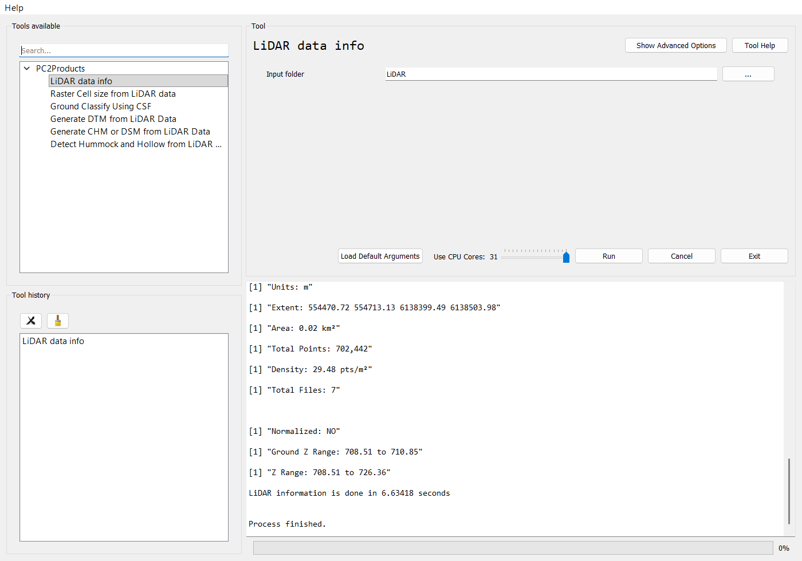

# LiDAR data info

Prints a summary of the LiDAR dataset to the console. It doesn't write any files.

| Item | How it's calculated |
|------|---------------------|
| Data format | LAS version (`Major.Minor`) of the first file |
| CRS / EPSG / Units | `sf::st_crs` of the catalog. Reports `Unknown` if the CRS is missing. |
| Extent | min X, max X, min Y, max Y across all tiles |
| Area | Catalog area in km² |
| Total Points | Sum of the point records in all tiles |
| Density | Total points / area, in pts/m² |
| Total Files | Number of LAS/LAZ files |
| Normalized | `YES` if the mean \|Z\| of the ground points is below 1 (first file only) |
| Ground Z Range / Z Range | Min and max Z of the ground points and of all points (first file only) |

| Parameter | Type | Required | Description |
|-----------|------|----------|-------------|
| `in_las_folder` | directory | Yes | Folder containing the input LAS/LAZ tiles. |
| `processes` | int | No | Requested number of parallel workers. |

```python
from beratools.tools.rpy_las_info import rpy_las_info

rpy_las_info(in_las_folder="tests/data/LiDAR")
```



## Command line

```bash
bt las_info   # show the parameters
bt las_info --in_las_folder <las_dir>
```
