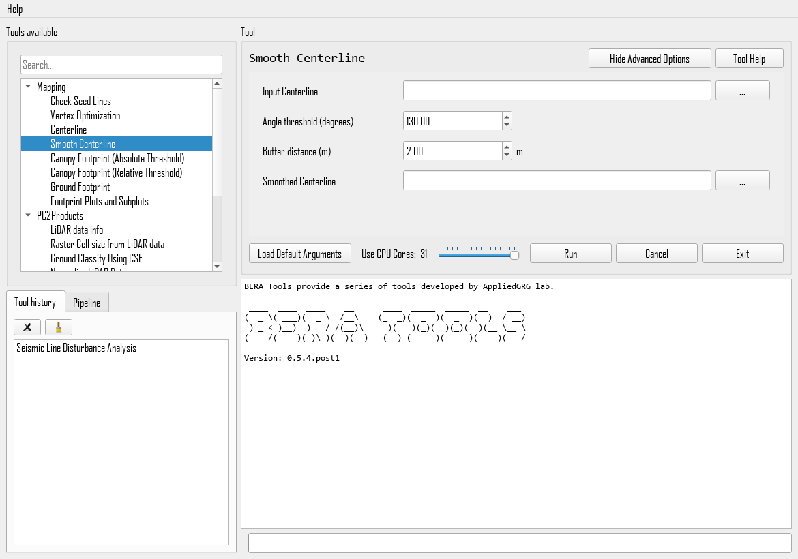

# Smooth Centerline

## What does this tool do?

**Smooth Centerline** removes sharp corners from centerlines. It changes only the vertices where the line turns sharply. Each sharp corner is cut off with a straight segment, and the rest of the line keeps its original vertices.

This differs from the smoothing options in [Centerline](centerline.md): **Smooth LCP** smooths every vertex of the line, and **Simplify Centerline** reduces bends along the whole line. Use this tool when the line is mostly right and only a few corners, such as zig-zags or spikes from the least-cost path, need fixing.

The tool is ported from [SegLine](https://github.com/IrinaTerentieva/SegLine) by Irina Terentieva.

## How do I use it?

### Quick Start

1. **Prepare your input file**: a centerline vector file (GeoPackage or Shapefile), for example the output of [Centerline](centerline.md).
2. **Run the tool** from GUI. The angle and buffer options are under **Show Advanced Options**:

   

3. **Open the output file** in your GIS software and compare it with the input lines.

## What options can I set?

- **Input Centerline**: Path to your input line file
- **Angle threshold (degrees)**: Vertices with an interior angle below this value are smoothed (default: `130`). An angle of 180° is a straight line and smaller angles are sharper corners, so a higher threshold smooths more vertices.
- **Buffer distance (m)**: Radius around a sharp vertex that is replaced by a straight cut (default: `2.0`). Larger values give a stronger cut.
- **Smoothed Centerline**: Path for the output file

## Tips

- All attributes and the input order of the lines are kept.
- The tool prints how many lines it changed. If it changed none, raise the angle threshold.
- Keep the buffer distance small compared with the line width, so cuts stay inside the footprint.
