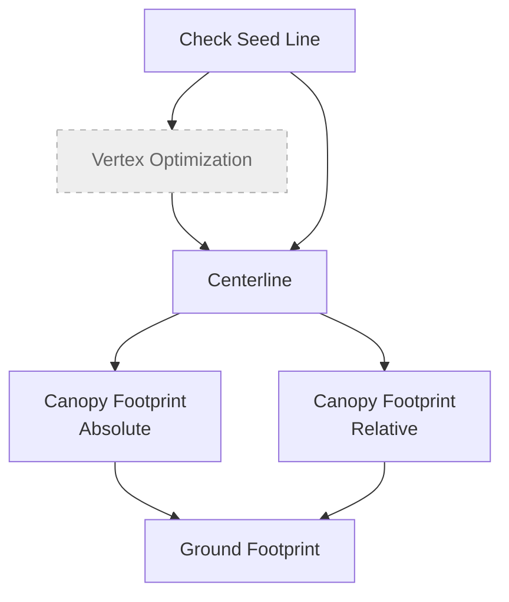
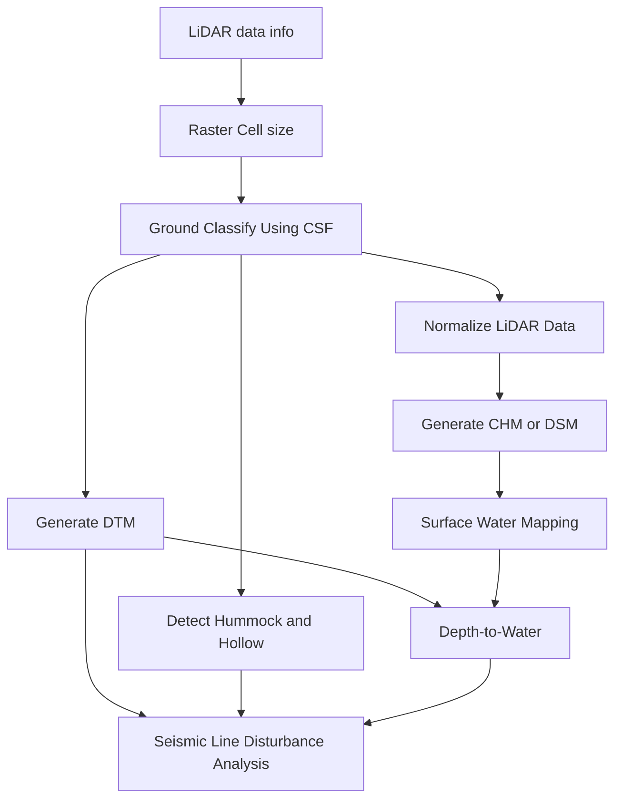

# Quick Start

Make sure [beratools is installed](user/installation.md). Run the command in MiniConda/Anaconda Prompt to start BERA Tools main gui.

``` bash
$ conda activate bera
$ beratools 
```

## Example Data

Start working with BERA Tools using example data.

[Download latest example data](https://github.com/BERATool/beratools/releases/latest/download/test_data.zip)

Sample LiDAR tiles for the PC2Products tools are in `tests/data/LiDAR/` of the source repository. The
examples on each PC2Products tool page use them.

## Main GUI

BERA Tools provide a light weight GUI to use tools.


The BERA Tools main GUI consists of the following components:

| **Panel / Section** | **Description** |
|----------------------|-----------------|
| **Tool Selection Panel (Left)** | A tree view listing all available tools, organized by toolbox. Users can search for tools using the search bar at the top. Selecting a tool updates the main panel. |
| **Tool History / Pipeline tabs (Left, below tool selection)** | **Tool history** lists recently used tools for quick access, with options to clear or remove items.<br>**Pipeline** chains tools into steps that run one after another (see [Building a pipeline](#building-a-pipeline)). |
| **Main Panel (Right)** | **Top Section:** Shows the currently selected tool name, with buttons for advanced options, viewing code, and help.<br>**Tool Parameters:** Dynamic widgets for entering parameters required by the selected tool.<br>**Bottom Section:** Includes a slider to select the number of CPU cores, a button to load default arguments, and buttons to run or cancel the tool. |
| **Output and Progress (Bottom Right)** | A text area displays output, logs, and messages from tool execution.<br>A progress bar and label show the status of running tools. |

## Workflow Diagram



### PC2Products (LiDAR) workflow

The **PC2Products** tools turn LiDAR point clouds into rasters. They run R through rpy2, so they need
R in the environment (see [Installation](user/installation.md#r-for-the-pc2products-lidar-tools)).



1. **[LiDAR data info](user/las_info.md)**: check the CRS, extent, density and whether the data is
   height-normalized.
2. **[Raster Cell size from LiDAR data](user/cellsize.md)**: preview the cell size that the raster
   tools will use.
3. **[Ground Classify Using CSF](user/gnd_csf.md)**: classify ground points if the data isn't
   ground-classified yet.
4. **[Generate DTM from LiDAR Data](user/dtm.md)**: build the bare-earth terrain model.
5. **[Normalize LiDAR Data](user/normalize.md)**: subtract the terrain from the point cloud, so that
   Z is height above ground.
6. **[Generate CHM or DSM from LiDAR Data](user/chm_dsm.md)**: build a CHM from the normalized
   tiles, or a DSM from the original tiles. The CHM can also be the CHM input of the mapping tools.
7. **[Detect Hummock and Hollow from LiDAR Data](user/hummock_hollow.md)**: map micro-topography from
   the ground-classified data.
8. **[Surface Water Mapping](user/surface_water.md)**: map surface water from a true-colour
   orthomosaic.
9. **[Depth-to-Water from Surface Water](user/dtw.md)**: krige a water table from the surface water
   and compute depth to water.
10. **[Seismic Line Disturbance Analysis](user/seismic_line_analysis.md)**: compare seismic lines
    with the surrounding peatland, using the DTM, hummock/hollow and depth-to-water rasters.

## Running the tools

=== "GUI"

    Select a tool, fill in the parameters and click **Run**. The tool's output streams into the log
    while it runs.

    

=== "bt command"

    ```bash
    bt list-tools                       # list the tool subcommands
    bt dtm                              # show the parameters for one tool
    bt dtm --in_las_folder <las_dir> --out_folder <out_dir> --style tin -p 4
    ```

    `bt` (also available as `beratools`) reads each tool's parameters from `beratools.json`, converts
    values to the right type and rejects anything that isn't one of a list parameter's allowed values.

=== "Python module"

    ```bash
    python -m beratools.tools.rpy_dtm_by --in_las_folder <las_dir> --out_folder <out_dir> --style tin
    ```

    `-p/--processes` sets the requested number of workers, and `-l/--log_level` sets the log level.

## Building a pipeline

The **Pipeline** tab, next to **Tool history** in the GUI, chains tools together so they run one
after another, without writing a script.

1. **Add steps**: drag tools from **Tools available** into the Pipeline tab. Dragging over the tab
   switches to it. You can also select a tool and click the add button. Drag steps, or use the arrow
   buttons, to change their order.
2. **Set each step's parameters**: click a step to open its parameters in the tool form. Your changes
   are kept in the step.
3. **Link steps**: **Inputs from earlier steps** sets which earlier step each input reads from, with one
   choice per input:
    - a line input (`in_line`) can come from **Check Seed Lines**, **Vertex Optimization**,
      **Centerline** or the centerline output of **Canopy Footprint (Relative Threshold)**;
    - a CHM input (`in_raster`, `in_chm`) can come from **Generate CHM or DSM from LiDAR Data**;
    - a footprint input (`in_footprint`) can come from a canopy footprint step;
    - a LiDAR folder (`in_las_folder`) can come from **Ground Classify Using CSF** or
      **Normalize LiDAR Data**;
    - a raster such as `in_dtm`, `in_microform`, `in_water` or `in_dtw` can come from the step that
      makes it. When the pipeline runs, the step reads that step's `Merged_*` mosaic, or its
      single-tile raster if there is only one tile.

    Each input links to the latest earlier step that makes what it needs, which is not always the
    step just before it, and the links are reset this way whenever a step is added, moved or
    removed, replacing any you chose by hand. Linked fields are greyed out in the form and show what
    they will read, for example `D:/rasters/Merged_*_DTM.tif`. Choose **Its own value** to use the
    path in the form instead. The list shows each step's links, for example
    `4. Seismic Line Disturbance Analysis ← steps 2, 3`.
4. **Run**: click **Run Pipeline**. The steps run in order with the CPU cores set by the slider, and
   their output streams into the log. The pipeline stops if a step fails, if a linked file is
   missing, or if you click **Cancel**.

For example, add **Ground Classify Using CSF**, **Normalize LiDAR Data**,
**Generate CHM or DSM from LiDAR Data**, **Centerline** and **Canopy Footprint (Absolute Threshold)**.
Normalization reads the classified tiles, the CHM step reads the normalized tiles, and both mapping
tools read that CHM; the footprint reads the centerlines. You only set the first step's input folder,
the seed lines, and each step's output.

### Saving and running a pipeline without the GUI

The buttons above the list save and load pipelines as `.json` files. A saved pipeline also runs from
the command line:

```bash
python -m beratools.core.pipeline my_pipeline.json --processes 4
```

!!! note
    A step only counts as failed if its tool exits with an error. Some tools print a warning and
    stop normally instead, for example **Generate DTM from LiDAR Data** on data that isn't
    ground-classified. The next step then fails on its missing input, so check the log.

Which inputs can link to which outputs is set in `beratools.json`, so new tools can join pipelines
without code changes. See [Taking part in pipelines](developer/add_new_tool.md#taking-part-in-pipelines).

## Data Preparation

BERA Tools start with two main types of input data:

- **CHM** (GeoTIFF).
- **Seed Lines** (polylines): rough centerlines of seismic lines, which helps to detect accurate centerline.

Ensure your input data meets the following criteria:

- **Vector Format**: Supported vector formats include GeoPackage (.gpkg), Shapefile (.shp).
- **Point Clouds**: the PC2Products tools read every LAS/LAZ file in an input folder.
- **Raster Format**: Supported raster formats include GeoTIFF (.tif).
- **Coordinate System**: Data should be in a projected coordinate system (e.g., UTM) for accurate distance measurements.

## Troubleshooting

### Windows GDAL/PROJ Warning

On Windows, BERA Tools may display a warning if `GDAL_DATA` or `PROJ_LIB` point to a different Python environment than the one running BERA Tools. This can happen when OSGeo4W or another GDAL install is configured globally while you run a conda/venv environment.

Example warning:

```
[GDAL/PROJ Warning] Potential env mismatch
Python env: C:\Users\you\miniconda3\envs\bera
GDAL_DATA : C:\OSGeo4W\share\gdal
PROJ_LIB  : C:\OSGeo4W\share\proj
If you encounter GDAL/PROJ errors, ensure these env paths belong to this Python environment.
```

**How to fix it**:
- Prefer GDAL/PROJ bundled with your current Python environment.
- Remove or update `GDAL_DATA`/`PROJ_LIB` to point into the active Python environment.

### PC2Products (LiDAR) tools

- **The first run is slow**: each tool installs the R packages it needs into the environment's R the
  first time. See [How all the tools behave](technical/tool_behaviour.md#how-all-the-tools-behave).
- **R can't be found**: see [How R is located](technical/tool_behaviour.md#how-r-is-located).
- **Windows, GDAL DLL errors**: run the tools from an *activated* environment.
- **Windows, rpy2 `IndexError` in `rpy2/situation`**: run the tools from PowerShell or cmd, not Git
  Bash.
